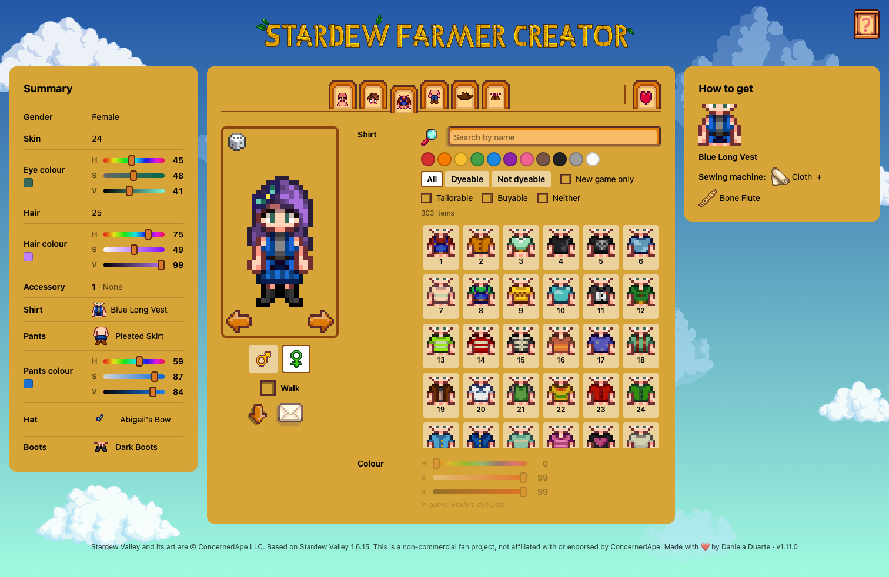
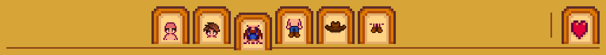
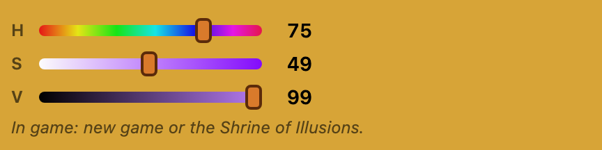
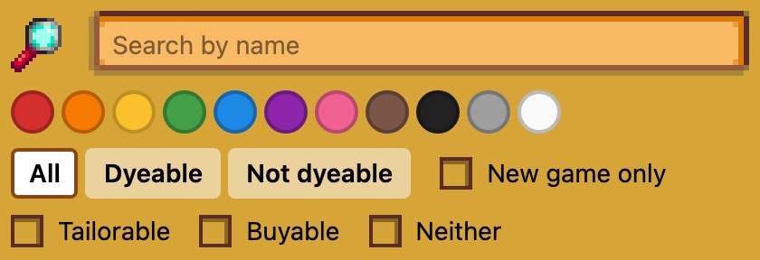
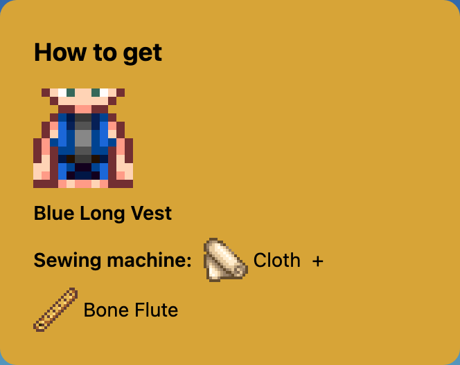
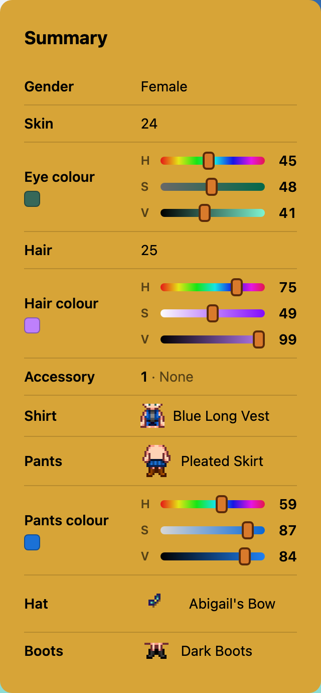
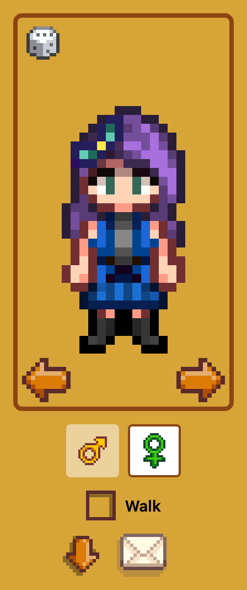
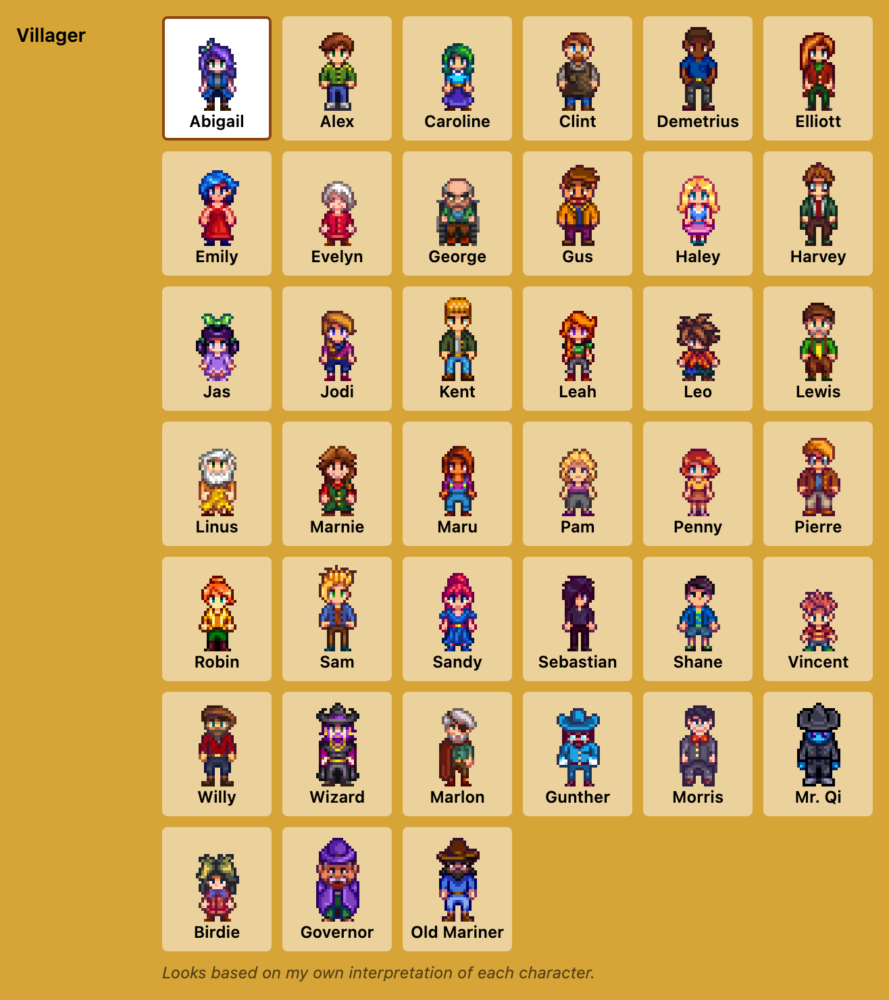
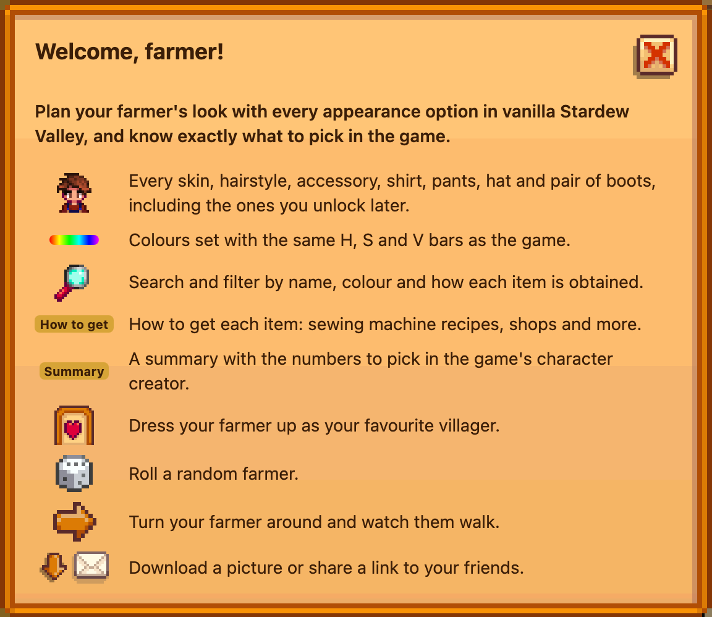

  

  <b>Plan your farmer's look with every appearance option in vanilla Stardew Valley, 
  and know exactly what to pick in the game.</b>

  🌱 <a href="https://stardewfarmer.pages.dev"><b>Open Stardew Farmer Creator</b></a> 🌱

  

## How to use

<table>
  <tr>
    <td align="center" width="50%"></td>
    <td>
      <h3>👕 Pick every piece</h3>
      Use the tabs to browse skins, hairstyles, accessories, shirts, pants, hats and boots. Every
      option in vanilla Stardew Valley is there, including the ones you unlock later.
    </td>
  </tr>
  <tr>
    <td>
      <h3>🎨 Colours like in the game</h3>
      Eyes, hair, pants and dyeable shirts use the same H, S and V bars as the game, so you can copy
      the numbers straight into it. A note under each colour tells you where to change it.
    </td>
    <td align="center"></td>
  </tr>
  <tr>
    <td align="center"></td>
    <td>
      <h3>🔍 Find anything</h3>
      Search by name, or filter by colour, dyeable, new game only, tailorable and buyable.
    </td>
  </tr>
  <tr>
    <td>
      <h3>🧵 Learn how to get it</h3>
      Hover or pick an item to see how to get it: sewing machine recipes, shops and more.
    </td>
    <td align="center"></td>
  </tr>
  <tr>
    <td align="center"></td>
    <td>
      <h3>📋 Copy it into the game</h3>
      The summary lists the numbers the game's character creator shows for each option, with the
      colour bars. Items you can't pick in a new game show their picture and name.
    </td>
  </tr>
  <tr>
    <td>
      <h3>🎲 Play with your farmer</h3>
      Turn your farmer around, watch them walk, roll a random farmer with the dice, download a
      picture or copy a link that keeps your whole outfit.
    </td>
    <td align="center"></td>
  </tr>
</table>

### 💜 Dress up as a villager
Pick a villager to see your farmer dressed like them.

  

### ❓ Need a reminder?
The **?** button at the top of the page opens a quick tour.

  

## Credits and legal
This is a non-commercial fan project. It is not affiliated with or endorsed by ConcernedApe.

- Stardew Valley and its art and data are © ConcernedApe LLC. Everything in `public/assets/`
  (the sprites and `catalog.json`) and `public/ui/` (favicons, title, icons) comes from the game
  and is **not** covered by this repository's licence. The screenshots in `docs/` show the
  game's art too. See [NOTICE](NOTICE).
- The source code is released under the [MIT License](LICENSE).
- Game files are unpacked with [StardewXnbHack](https://github.com/Pathoschild/StardewXnbHack) by Pathoschild.
